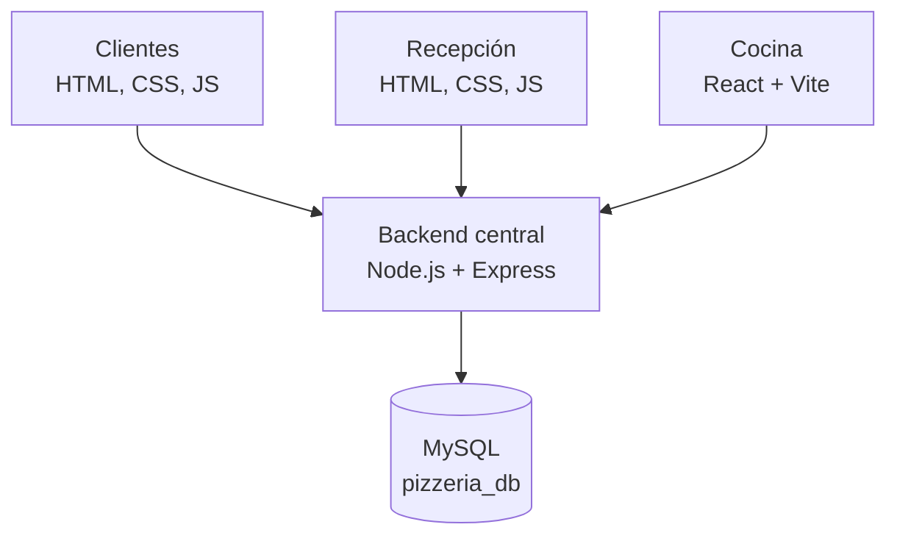

# Sistema de Gestión para Pizzería

Aplicación web desarrollada como proyecto académico bajo una dinámica de **Sprint**, cuyo objetivo es integrar en un solo flujo operativo los módulos de **Clientes, Recepción y Cocina**.

El sistema permite gestionar el recorrido de un pedido desde que el cliente consulta el menú y realiza su compra, hasta que el personal de cocina lo prepara y recepción registra su entrega. Los módulos comparten una API REST y una base de datos MySQL para mantener la información sincronizada.

> **Estado del proyecto:** versión integrada preparada para pruebas locales. La validación completa del flujo debe realizarse en un entorno con MySQL configurado.

## Funcionalidades principales

- **Clientes:** consulta del menú, registro e inicio de sesión, carrito, creación de pedidos y seguimiento por folio.
- **Recepción:** visualización y gestión de pedidos activos, actualización de estados y control de entrega o reparto.
- **Cocina:** recepción de pedidos, control de preparación, registro de tiempos, paso por horno y marcado de pedidos listos.
- **Catálogo centralizado:** productos y precios consultados desde MySQL.
- **Flujo compartido:** los cambios de estado realizados en Cocina y Recepción se reflejan en el seguimiento del pedido.

## Stack tecnológico

| Área | Tecnologías |
|---|---|
| Frontend de Clientes | HTML5, CSS3, JavaScript |
| Frontend de Recepción | HTML5, CSS3, JavaScript |
| Frontend de Cocina | React 18, Vite 5, JavaScript (ES Modules) |
| Backend | Node.js, Express 5 |
| API y acceso a datos | API REST, mysql2 |
| Base de datos | MySQL 8 |
| Control de versiones | Git y GitHub |

## Arquitectura general

Se utiliza una arquitectura cliente-servidor. Los tres módulos consumen un backend centralizado; este procesa las solicitudes y consulta una única base de datos MySQL.



Esta organización evita mantener catálogos y pedidos independientes por módulo y permite compartir el estado de cada orden.

## Flujo de un pedido

1. El cliente consulta el catálogo, inicia sesión y registra un pedido.
2. El backend valida la solicitud, obtiene los precios desde la base de datos y guarda el pedido.
3. Recepción consulta el pedido dentro de la lista de órdenes activas.
4. Cocina recibe la orden y actualiza su avance durante la preparación y el proceso de horno.
5. Al marcarse como listo, Recepción puede continuar con la entrega o el reparto.
6. El cliente consulta el estado actualizado mediante su folio.

**Estados principales:**

- Pedido estándar: `REGISTRADO → EN_COCINA → LISTO → COMPLETADO`
- Pedido a domicilio: `REGISTRADO → EN_COCINA → LISTO → EN_REPARTO → COMPLETADO`

## Autenticación y manejo de datos

- Registro e inicio de sesión de clientes mediante endpoints de autenticación.
- Las contraseñas se procesan con `scrypt` y salt aleatorio; no se almacenan en texto plano.
- La sesión se gestiona mediante cookie `HttpOnly` y el token de sesión se almacena como hash en MySQL.
- Los pedidos de clientes se asocian a su cuenta para limitar el seguimiento a sus propios pedidos.
- Los precios se consultan en el backend; el cliente no determina el importe final enviando valores desde el navegador.

## Estructura del proyecto

```text
Pizzeria_Integrada/
├── FrontendPizzeria-client/           # Interfaz de clientes
├── FrontendPizzeria-feature-recepcion/ # Panel de recepción
├── FrontendPizzeria-feature-cocina/    # Aplicación React de cocina
├── pizzeria-backend/                  # API REST y conexión MySQL
├── database/                          # Instalación y migraciones SQL
└── README.md
```

## Ejecución local

**Requisitos:** Node.js 18 o superior y MySQL 8 o superior.

1. Crea la base de datos ejecutando `database/instalacion.sql` en MySQL Workbench.
2. En `pizzeria-backend`, configura las variables de conexión en un archivo `.env` a partir de `.env.example`.
3. Inicia el backend:

   ```bash
   cd pizzeria-backend
   npm install
   npm start
   ```

4. Abre Clientes en `http://localhost:3000/cliente/` y Recepción en `http://localhost:3000/pages/recepcion.html`.
5. Para Cocina, abre otra terminal y ejecuta:

   ```bash
   cd FrontendPizzeria-feature-cocina
   npm install
   npm run dev
   ```

   Utiliza la dirección local que indique Vite (normalmente `http://localhost:5173`).

**Importante:** no publiques el archivo `.env`, contraseñas ni credenciales reales. Para este proyecto se contempla una ejecución local de desarrollo; un despliegue público requiere configurar HTTPS, variables de entorno seguras, CORS y un servidor de producción.

## Alcance y consideraciones

- Proyecto académico enfocado en integración de módulos y gestión del flujo de pedidos.
- La aplicación registra información del método de pago, pero **no procesa pagos reales** ni integra una pasarela bancaria.
- La versión documentada está orientada a desarrollo y pruebas locales; no se presenta como un despliegue productivo.

## Aprendizajes y conceptos aplicados

- Integración de interfaces desarrolladas con tecnologías distintas.
- Diseño y consumo de una API REST compartida.
- Conexión de Node.js con MySQL y persistencia de información.
- Autenticación, manejo de sesiones y almacenamiento seguro de contraseñas.
- Modelado de estados y coordinación de un flujo operativo entre diferentes roles.

---

**Proyecto académico — Sistema de Gestión para Pizzería**
